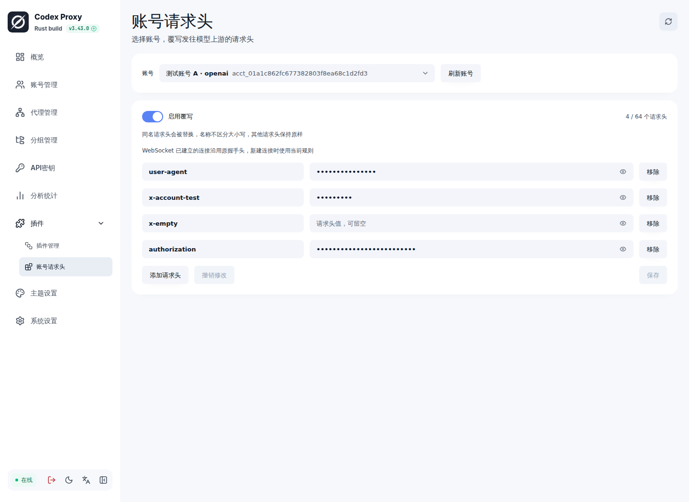
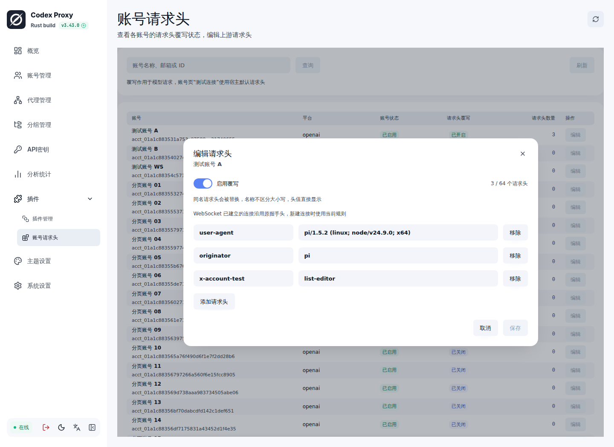
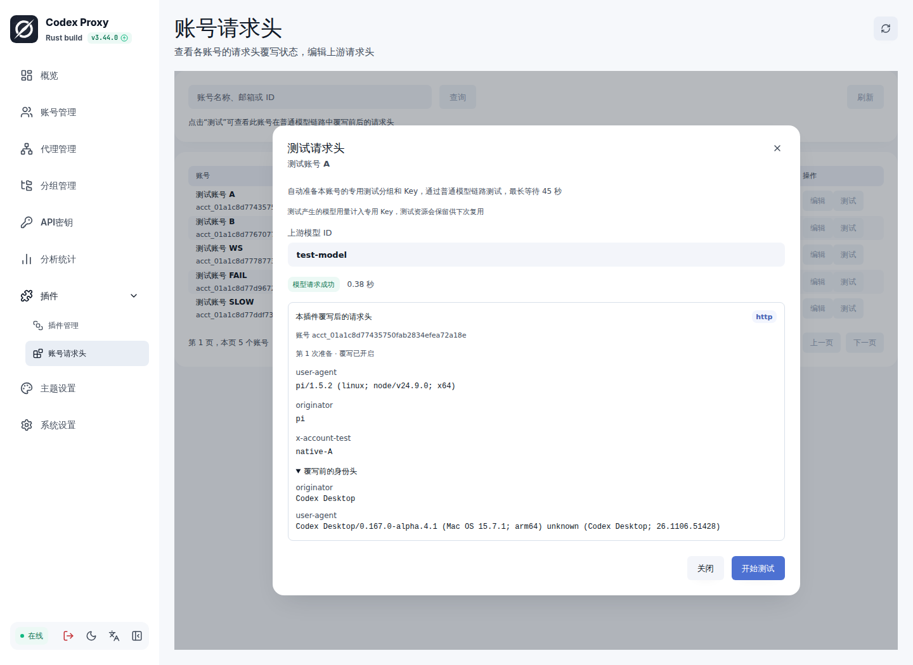

# 账号请求头插件

为选定账号覆写发往模型上游的请求头，提供宿主管理端扩展页

## 使用

1. 从 [Releases](https://github.com/SilentFlower/cpr-account-headers/releases/latest) 下载服务器平台对应的 `.tar.gz` 安装包，在 CPR 插件管理中上传，接受完整信任并启用实例
2. 核对自动创建的 `outbound` 中间件绑定，按需限制 Provider、模型或分组范围
3. 从扩展页打开「账号请求头」，列表显示每个账号的覆写开关和请求头数量，可按名称、邮箱或 ID 搜索
4. 点击账号行的「编辑」，在弹窗中设置请求头名称和值，打开「启用覆写」并保存
5. 点击账号行的「测试」，填写模型 ID 后开始测试，查看模型结果与本插件记录的请求头前后对照

也可通过 CPR 的 GitHub 安装入口填写仓库 `SilentFlower/cpr-account-headers`，选择对应平台的 Release 附件，标签留空使用最新稳定版

每个账号单独保存规则，支持 OpenAI 与 xAI 账号。头名不区分大小写，配置值替换原请求全部同名字段，缺失字段会追加。值留空表示发送空值，移除配置项后恢复宿主生成的原始字段。关闭「启用覆写」保留配置并恢复原请求头

头值直接显示，便于查看和编辑。每个账号最多 64 项、64 KiB，名称重复或含非法字符时拒绝保存。保存采用精确版本检查，遇到并发修改或结果待确认时重新读取规则后继续编辑

## 请求头测试

点击账号行的「测试」，填写模型 ID 后开始。测试通过原版宿主的页面模型桥进入普通模型链路，使用所选账号和已保存规则，展示本插件记录的请求头前后对照、耗时和模型响应

首次测试会为该账号创建一组插件专用分组和 Key，分组只包含此账号。后续测试复用同一组资源，模型用量计入专用 Key，账号原有分组保持不变。资源可在管理端按「请求头测试」查找；分组或 Key 被停用、范围被修改时会提示处理

支持手动停止、关闭弹窗取消和 45 秒期限，每个插件进程最多同时执行 4 个测试，同一账号串行执行。请求结果按宿主返回的模型请求 ID 与出站记录关联，缺少对应记录时提示检查插件绑定

对照记录来自本插件的真实出站处理器，显示 `user-agent`、`originator`，开启覆写时也显示已配置字段。其他外层插件仍可能继续处理请求，最终发送结果以模型响应为准

## 扩展页

以下页面使用合成账号和请求头值展示



[深色主题](docs/screenshots/dark.png) · [窄屏布局](docs/screenshots/mobile.png) · [窄屏操作区](docs/screenshots/mobile-actions.png)





[测试深色主题](docs/screenshots/test-dark.png) · [测试窄屏布局](docs/screenshots/test-mobile.png)

## 作用范围

- 使用 `middleware v6` 的 `outbound` 阶段，在 Provider 序列化完成后覆写头部，目标 URL、正文与账号归属保持原样
- 支持模型 HTTP 请求与 WebSocket 候选握手头，OAuth、额度刷新等后台请求沿用宿主行为
- 账号页「测试连接」沿用原生诊断；插件页「测试」使用专用单账号 Key 进入普通模型链路，账号资格、租约、并发与用量由宿主维护
- WebSocket 已建立连接沿用原握手头，新建连接使用当前规则，精确续接由宿主管理
- `Authorization` 等认证头也按配置值覆写，实际发送仍受 HTTP 和 WebSocket 传输格式约束，WebSocket 握手头值要求 ASCII
- 多个中间件按宿主绑定顺序组合，本插件在下层准备完成后应用覆写，外层中间件仍可继续处理
- 规则保存在当前插件实例的私有状态中，停用再启用或进程重启后保留，每次上游准备读取当前账号规则，状态读取失败时本次准备返回错误

## 兼容与构建

面向 CPR `>=3.43.0`，使用清单 v2、RPC v7、`middleware v6` 与 `management v2`。SDK 固定到 `1a2a4a56aed0a9660f173cb1d125b9728e2f214c`，UI 固定为 `@codex-proxy/ui 0.8.0`

需要 Rust `1.99.1`、Node.js `>=24`、pnpm `12.6.0` 和与目标 SDK 合同匹配的 `cpr-plugin`

```bash
cargo fmt -- --check
cargo clippy --all-targets --all-features --locked -- -D warnings
cargo test --locked
pnpm --dir frontend install --frozen-lockfile
pnpm --dir frontend lint
pnpm --dir frontend build
CPR_PLUGIN_CLI=/path/to/cpr-plugin bash scripts/package.sh
```

默认构建 Linux x86_64，可用 `CPR_PLUGIN_TARGET` 指定已有工具链支持的平台。构建脚本生成页面、二进制、第三方许可和带 SHA-256 校验文件的安装包，源码目录保持独立于宿主 workspace

测试使用真实插件子进程和模拟宿主回调，覆盖账号隔离、覆写与透传、分页、状态重启恢复、并发冲突、单账号测试资源校验、真实出站记录关联、错误与取消

本地集成验收使用原版宿主、独立数据库与合成上游，线上账号的实际结果在相关 Issue 中继续反馈

## 许可证

Apache-2.0，第三方依赖许可见 `THIRD_PARTY_LICENSES.txt`
